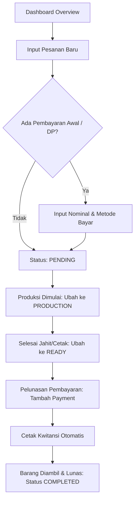

# 📊 Analisis Proyek: POS & Sistem Manajemen Pesanan Konveksi
**CV. Aksara Inovatif** *(finance-dashboard)*

---

## 1. 📖 Ringkasan Proyek

Meskipun repositori ini awalnya dinamai `finance-dashboard`, proyek ini telah dibangun dan disesuaikan menjadi **Sistem POS (Point of Sale) & Order Management Konveksi** untuk **CV. Aksara Inovatif**.

Sistem ini membantu operasional usaha konveksi dalam:
- Mengelola pesanan produksi pakaian/merchandise (lanyard, kaos, seragam, dsb).
- Mencatat data pelanggan dan spesifikasi pesanan custom.
- Memantau tahapan produksi (`PENDING`, `PRODUCTION`, `READY`, `COMPLETED`, `CANCELLED`).
- Mengelola arus pembayaran (Down Payment / DP, Cicilan, Pelunasan).
- Menghitung sisa tagihan dan ringkasan omset secara real-time.
- Mencetak kwitansi pembayaran resmi dengan generator kalimat terbilang rupiah otomatis.

---

## 2. 🛠️ Tech Stack & Arsitektur

### Frontend & Backend (Full-stack)
- **Framework:** [Next.js](https://nextjs.org/) (App Router, v16 / React 19)
- **Language:** TypeScript
- **Styling:** Tailwind CSS v4
- **Icons:** Lucide React
- **Visualisasi & Charts:** Recharts

### Database & Data Access
- **Database Engine:** PostgreSQL 17 (berjalan lokal di port 5432)
- **ORM:** Prisma 7 (`@prisma/client`, `@prisma/adapter-pg`)
- **Migrasi:** Prisma Migrate (`prisma/migrations/`)

---

## 3. 📂 Struktur Direktori Utama

```
finance-dashboard/
├── app/                        # Next.js App Router
│   ├── api/                    # Endpoint API backend
│   │   ├── customers/          # CRUD Pelanggan
│   │   ├── orders/             # CRUD Pesanan
│   │   ├── payments/           # Pencatatan Pembayaran
│   │   ├── receipts/           # Data Kwitansi Cetak
│   │   └── summary/            # Agregasi Ringkasan Finansial & Order
│   ├── receipts/[id]/          # Halaman tampilan cetak kwitansi resmi (auto-print)
│   ├── layout.tsx              # Root layout aplikasi
│   ├── page.tsx                # Dashboard utama (Overview, Tabel Order, dsb)
│   └── globals.css             # Konfigurasi CSS Tailwind
├── components/                 # Komponen antarmuka pengguna (UI)
│   ├── AddOrderModal.tsx       # Modal input pesanan baru & DP awal
│   ├── AddPaymentModal.tsx     # Modal input pembayaran tambahan / cicilan
│   ├── OrderDetailModal.tsx    # Modal detail order, timeline status, & list kwitansi
│   └── SummaryCard.tsx         # Kartu ringkasan metrik statistik
├── lib/                        # Modul utility & konfigurasi
│   ├── prisma.ts               # Inisialisasi Prisma Client dengan PgAdapter
│   ├── company-config.ts       # Profil perusahaan, status order, warna label
│   ├── number-to-words.ts      # Generator kalimat terbilang rupiah otomatis
│   └── utils.ts                # Helper format mata uang (Rupiah) & tanggal
├── prisma/                     # Konfigurasi & skema database
│   ├── schema.prisma           # Definisi model data (Customer, Order, Payment)
│   ├── migrations/             # Riwayat migrasi SQL
│   └── seed.ts                 # Script seeder data awal
├── docs/                       # Dokumentasi proyek & database
│   ├── analisis-proyek.md      # Dokumen ini
│   └── setup-db.md             # Panduan pengelolaan database
└── .env                        # Konfigurasi database connection string
```

---

## 4. 🔄 Alur Operasional Sistem (Workflow)



### Penjelasan Tahapan:
1. **Ringkasan Finansial (Dashboard):**
   - Menampilkan total omset pesanan, total yang sudah terbayar, sisa piutang/pending, serta omset hari ini.
   - Menampilkan counter pesanan aktif berdasarkan status produksi.
2. **Pendaftaran Pesanan (`AddOrderModal`):**
   - Kasir/admin memilih pelanggan yang sudah ada atau memasukkan pelanggan baru.
   - Menentukan detail pesanan (nama barang, jumlah, satuan pcs/lusin/kodi, harga per unit).
   - Menentukan tenggat waktu (*due date*) dan spesifikasi teknis (warna kain, sablon, ukuran).
   - Opsi input DP langsung untuk membuat pembayaran pertama.
3. **Pembaruan Status Produksi (`OrderDetailModal`):**
   - Operator dapat mengubah status bertahap dari `PENDING` ➔ `PRODUCTION` ➔ `READY` ➔ `COMPLETED`.
4. **Pencatatan Pembayaran Lanjutan (`AddPaymentModal`):**
   - Pelanggan dapat mencicil atau melunasi sisa tagihan.
   - Sistem otomatis menghitung sisa tagihan yang belum dibayar.
5. **Pencetakan Kwitansi (`/receipts/[id]`):**
   - Setiap pembayaran memiliki nomor kwitansi unik.
   - Menghasilkan format kwitansi siap cetak dengan logo, kop CV. Aksara Inovatif, rincian barang, nominal angka, kalimat terbilang rupiah otomatis, dan tanda tangan kasir.

---

## 5. 🚀 Cara Menjalankan Aplikasi Web

### Prasyarat:
- Node.js (versi 18+)
- PostgreSQL service sedang berjalan (Windows Service: `postgresql-x64-17`)

### Langkah-langkah:
1. Pastikan dependensi sudah terpasang:
   ```powershell
   npm install
   ```
2. Jalankan server development:
   ```powershell
   npm run dev
   ```
3. Buka browser pada alamat:
   ```
   http://localhost:3000
   ```
